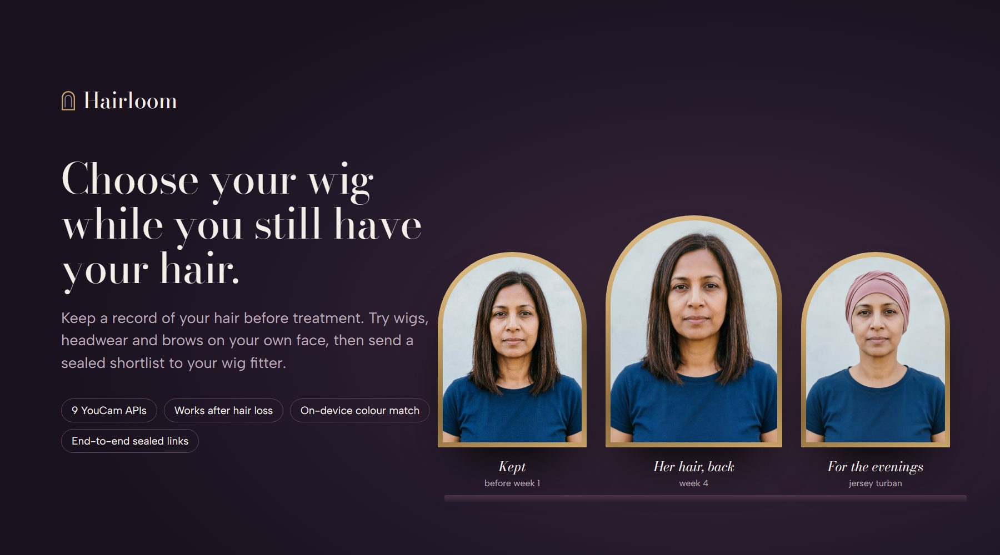

<p align="center"></p>

<p align="center">
  
  
  
  
  
</p>

<p align="center">
  <b><a href="https://hairloom-studio.vercel.app">Live site</a></b> ·
  <b><a href="https://hairloom-studio.vercel.app/studio?p=anjali">Studio with a demo person</a></b> ·
  <b><a href="https://hairloom-studio.vercel.app/fitter#demo">Fitter desk</a></b> ·
  <b><a href="https://hairloom-studio.vercel.app/business">For retailers</a></b> ·
  <b><a href="https://hairloom-studio.vercel.app/evidence">Evidence</a></b>
</p>

**Hairloom** helps people facing hair loss choose a wig while they still have their hair, and keep choosing after. It keeps a *hair passport* before treatment: curl pattern, frizz, length, face shape and brows from the YouCam API, plus a wig shade code measured on the device. Later it puts that hair, any wig, a headscarf or rebuilt brows back on the person's own photo, even after hair loss. The shortlist goes to their wig fitter in an end-to-end sealed link.

What it does that a wig catalogue can't:

- **Your own hair, back on your week-4 photo**, from the photo you kept (Hairstyle Try-On worked on 8 of 8 try-ons on four real shaved heads).
- **A sealed fitter brief** with a pull list in your shade code and cap size, encrypted in the browser.
- **The shop's own stock, ranked against your passport**: paste a catalogue on the fitter desk, or ask through the MCP server.
- **Beyond chemotherapy**: alopecia areata, pattern thinning and men, through Hair Volume and Hair Extension try-ons.
- **11 YouCam APIs**, each doing one job, with every task we kept in a public evidence ledger, failures included.

About 65% of people having chemotherapy lose hair. Hair usually starts to fall out two to three weeks after the first cycle, and cancer charities advise matching a wig *before* that happens. Most wig shops take returns only if the wig hasn't been worn, and some take none. That makes wigs the retail category where trying on before buying matters most, and where it is hardest to do. Sources are listed on the [evidence page](https://hairloom-studio.vercel.app/evidence#sources).

## Try it in a minute

1. Open the [studio with Anjali](https://hairloom-studio.vercel.app/studio?p=anjali). Anjali is a demo person, and every image is precomputed YouCam output, so nothing costs units. Nia (alopecia), Margaret and Ravi are there too.
2. **Keep:** read her hair passport, with curl, frizz, length, face shape, brows, head size and her colour as a wig shade code.
3. **Try:** pick wigs on her photo before hair loss, then switch to week 4. Wigs are ranked by how close each is to the hair she kept. You can drag across the mirror to compare, recolour a wig to a closer shade, or (as Margaret) preview fuller volume and clip-in length on a photo of thinning hair.
4. **Brows & headwear**, then **Share:** create a sealed link and open it as the fitter.

Or choose *Use my own photos*. YouCam's JS Camera Kit guides you through the three angles.

## What each YouCam API does here

| YouCam API | Job in Hairloom |
|---|---|
| Hairstyle Virtual Try-On v2.1 (`hair-transfer`) | Every wig on the user's face. With the kept photo as the reference, it also puts the user's own hair back onto a week-4 photo. |
| Hair Type Detection | Curl pattern (1 to 4C) from three angles, for matching texture. |
| Hair Frizziness Detection | How much frizz the fitter should match. |
| Hair Length Detection | The user's length today. In the fitter desk it also tags stock photos. |
| Face Attribute & Ratio Analyzer | Face shape, plus brow shape, thickness and colour. |
| Makeup Virtual Try-On (eyebrows) | Brows rebuilt in the kept shape and shade, for when they thin. |
| Hair Color Virtual Try-On | Recolours a chosen wig to the stock shades nearest the kept hair. |
| Hair Volume Virtual Try-On | Previews fuller lengths and sides for thinning hair, on a photo of the thinning hair. It doesn't cover a thin crown, and the studio says so. |
| Hair Extension Virtual Try-On | Shows clip-in length on the kept photo. |
| AI Image Generator (image to image, text to image) | Headwear, with an instruction to keep the face (the mirror lets you drag back to compare). It also generated the demo people and the fictional boutique's stock. |
| AI Skin Analysis v2.1 | Optional skin check-ins in the journal, once per treatment cycle, using raw scores and concern maps. |
| JS Camera Kit (an SDK, not one of the 11 APIs) | Guided three-angle capture (`hairtype` mode). Built in, but not yet tested on a real phone. |

## What we measured

[Evidence](https://hairloom-studio.vercel.app/evidence) lists every YouCam task whose output we kept (257: 188 for the demo, 41 on real photographs, 28 early research), including the image generation that made the demo, with success counts, median times, the errors we hit and what they taught us. The studio's 12 task kinds call 11 distinct YouCam APIs (the wig and own-hair kinds share hair-transfer), and each has at least one successful run in the ledger. `node scripts/export-runs.mjs` rebuilds it from the lab outputs. Highlights:

- **Hairstyle try-on works on a bald head.** On the four demo people's after-hair-loss photos, 64 of 64 wig try-ons and 4 of 4 own-hair restorations succeeded, and so did 8 of 8 wig try-ons on four real shaved heads (stock photos). On a generated photo with bare patches, a wig try-on covered them; a volume try-on didn't. The generator draws patches pink, so real patchy hair loss and tests on people with hair loss are next.
- **Regrowth re-read.** Kept: type 1 to 2A, above chest. Now: 3B to 3C, short. The regrowth photos were generated asking for short, curlier regrowth (2–3 cm), so this shows the detections reading new growth, not a prediction of chemo curls. The journal compares the two and ranks wigs for the new growth.
- **Density detection** rejected all six photos in the ledger, including crown photos tilted about 30° forward and front-facing selfies from 45° below and above, so it isn't in the studio.
- **Light shades need full intensity.** Margaret's three blonde recolours landed a median ΔE00 17.1 from the asked shade at colour intensity 70, and 11.0 at 100, so shades lighter than L* 55 are now asked at 100.
- **Real photos were stricter than generated ones.** Face Attribute rejected 5 of 5 real portraits at the default angle strictness and read 5 of 5 at `flexible`; hair length read 2 of 5.
- **Hair colour comes back from YouCam as a named category.** A wig fitter needs a shade code, so Hairloom measures colour from the hair pixels: MediaPipe's hair segmenter running in the browser, then a trimmed CIELAB median and CIEDE2000 against 20 common wig shades. YouCam's label is kept beside it. On the generated demo people it said "Blonde" every time it answered, whatever the hair, so those matches are chance. On real photos it fit the hair on 2 of the 3 it labelled (by eye, no reference swatch yet).
- **`task/delete` really deletes.** Afterwards the result URL returns 404 and the input file can't be reused (403).
- **Hair type and frizz need three same-size photos in a fixed order.** The order is front, then face towards the right of the picture, then towards the left. Anything else returns `error_face_angle_invalid` or `error_mismatch_image_size`.
- **Hat try-on restyles the whole outfit.** On a bald head it once added hair under a beanie. Headwear uses image-to-image with an instruction to keep the face instead.

## For a fitter's AI assistant (MCP)

Hairloom is also an MCP server (Streamable HTTP) at `https://hairloom-studio.vercel.app/api/mcp`. Add it to Claude or another assistant that supports remote MCP servers.

| Tool | What it does |
|---|---|
| `match_wigs` | Ranks stock against a client's passport and gives a pull list in the client's shade, with a cap note. |
| `shade_for_colour` | Turns a hair colour hex into common wig shade codes, using CIEDE2000. |
| `list_stock` | Browses the boutique's wigs, with their listed shade codes. |
| `show_on_demo_person` | Returns a precomputed YouCam try-on of a wig on a demo person. |
| `fitting_plan` | Gives the dates to plan around treatment, from ACS, CRUK and Macmillan guidance. |
| `fitting_cost` | Gives the YouCam units and dollars for a fitting. |

The server never sees client photos. For live try-ons, pair it with YouCam's hosted MCP servers (`/mcp/fashion`, `/mcp/beauty`). `node scripts/mcp-check.mjs <url>` runs a smoke test. `match_wigs` takes a shop's own `stock` (with SKU, shade code, cap sizes and product URL) and returns hold notes; `match_wigs` and `shade_for_colour` take the passport's grey share and suggest a grey blend.

On the [fitter desk](https://hairloom-studio.vercel.app/fitter#assistant), **Ask the fitter desk** walks the same tools in order (`match_wigs`, `shade_for_colour`, `fitting_plan`, `show_on_demo_person`) for the open brief and ends in a pull list. It is a fixed, rules-based plan, not a language model, so it costs no model calls and no YouCam units; each step is a real call to `/api/mcp`.

**Your own stock:** paste a catalogue as CSV or JSON on the fitter desk ([template](https://hairloom-studio.vercel.app/stock.example.json): sku, name, length, texture, shade, caps, price_inr, fit, url). A second example, [`stock.public-listings.json`](https://hairloom-studio.vercel.app/stock.public-listings.json), holds 13 real wigs from two retailers' public product pages (metadata only, no images, no partnership). Stock is ranked in the browser with the studio's closeness score and gives a hold note per wig ("Please hold KC-ASHA-2 in shade 4, cap Average…") and a "View at retailer" link. Nothing is uploaded. The retailer widget takes `&shop=<https product page>` to show a "Reserve in shade …" handoff.

## For retailers and wig banks

[The business page](https://hairloom-studio.vercel.app/business) covers who pays and what a fitting costs.

- **Who pays:**
  - Patients never pay.
  - Boutiques pay per client brief.
  - Wig brands embed [a widget](https://hairloom-studio.vercel.app/embed?wig=asha).
  - Hospitals and wig banks sponsor passports.
- **What it costs:** a chemotherapy wig fitting is 41 YouCam units ($1.97–2.26), a thinning session 12 and a sponsored passport 22. The cost table is built from the studio's own task list and matches the MCP `fitting_cost` tool.
- **Draft prices:**
  - ₹399 + GST per fitter brief.
  - ₹99 per widget shop session (capped at 10 units).
  - ₹150 per sponsored passport, which covers 500 patients for ₹75,000. Health care is an eligible CSR activity under section 135 of India's Companies Act.
- **Does it pay a boutique?** At the labelled defaults (30 clients a month, half a visit saved, 5% buying one more wig at a 40% margin), the boutique nets about ₹5,130 a month. One extra wig a month covers it, and Hairloom keeps about half the fee after YouCam's pay-as-you-go price.
- **The market for YouCam:**
  - About 40% of women show pattern thinning by 50 (DermNet), and alopecia areata has a 2% lifetime incidence.
  - The medical wig segment is projected at $1.9B by 2035 (GMI).
  - These are the same hair try-ons Perfect Corp already sells, bought by people who need them more.
- **Pilot:** eight weeks with one oncology wig bank or boutique in India, judged on three thresholds: 60% of patients keep a passport before hair loss, 25% fewer fitting visits, and 80% of wigs still worn at four weeks.

## Privacy

- **Photos and passport** live only in the browser (IndexedDB). There are no accounts and no photo copy on our server.
- **Colour** is measured on the device.
- **YouCam tasks:** photos pass through our server's memory to YouCam and are written nowhere on our side. Every task's result is downloaded by our server, then the browser confirms receipt and the task is deleted with `task/delete`, which removes the input photo too. If the tab closes mid-task, the page sends the delete as it closes. Failing that, a capped sweep runs after studio requests at most every 10 minutes (a compare-and-swap marker in the bucket lets one instance run it) and deletes results left uncollected for 11 minutes; the daily cron catches the rest.
- **Fitter links** are encrypted with AES-GCM in the browser. The server stores only ciphertext, in a private GCS bucket reached through keyless workload identity federation. Shares are deleted after 60 days by a bucket lifecycle rule. The key lives in the URL fragment, which never reaches a server.
- **What the server does keep:** a per-day count of YouCam units used (one number per date, in the same bucket), and in memory only, hourly unit and link-creation tallies per IP address. No photos, no readable health data, no analytics or cookies. See [/privacy](https://hairloom-studio.vercel.app/privacy).

## Architecture

```
browser                                   server (Next.js on Vercel)                YouCam API v2
──────────────────────────────            ───────────────────────────               ─────────────
Camera Kit / upload → resize       ──▶   /api/try  whitelist of 12 task kinds ──▶  file upload → task
MediaPipe hair mask → Lab → ΔE00          unit floor + per-visitor budget            poll → result
MediaPipe face crop (skin)         ◀──   download result, then task/delete   ◀──
IndexedDB passport + renders
AES-GCM seal  ─────────────────────▶   /api/share  ciphertext only ──▶ GCS (WIF, no keys)
```

- `lib/kinds.ts`: the whitelist. The server builds every request body and validates options before anything is uploaded.
- `lib/guard.ts`: spend controls.
  - Units are reserved before any await and released on failure.
  - A global daily cap applies.
  - Task handles are HMAC-signed, so polls only reach YouCam for tasks this server started.
- `lib/youcam.ts`: upload, task, poll, delete and live unit balance.
- `lib/hairColor.ts`, `lib/color.ts`: on-device hair colour, CIELAB and CIEDE2000.
- `lib/seal.ts`, `app/api/share`: sealed fitter links. A decrypted share is validated with zod before rendering, and the fitter desk runs under a strict Content Security Policy.
- `components/studio/*`: Keep, Try, Brows & headwear, Share.
- `components/fitter/*`: the fitter desk and stock auto-tagging.
- `components/journal/*`: the treatment timeline (with .ics export) and skin check-ins.

## Run it

```bash
npm install
echo "YOUCAM_API_KEY=sk-..." > .env.local   # from the YouCam API console
npm run dev                                   # http://localhost:3141
```

- **Demo people** work without a key.
- **Live runs** have spend controls, all env-tunable:
  - The public lane stops at `UNIT_FLOOR` (default 120) or at the judges' floor plus what judges may still use today, whichever is higher. The judges' floor is `JUDGE_UNIT_FLOOR` (default 20) and the reserve is capped at `JUDGE_RESERVE_UNITS` (default 250).
  - Daily caps are `GLOBAL_DAILY_UNITS` (public, default 120) and `JUDGE_DAILY_UNITS` (default 300).
  - Every YouCam call goes through one limit of `YOUCAM_CALLS_PER_MINUTE` (default 40) per instance, with `YOUCAM_JUDGE_CALLS_PER_MINUTE` (default 10) kept for judges.
  - Tasks are settled on the server after each start, so a failed task is refunded even if the browser never polls. A daily cron (`/api/cron/settle`, `CRON_SECRET`) sweeps what is left.
- **Shares** are written to `.data/` locally. Set `GCS_BUCKET` and `GCS_WIF_AUDIENCE` for production.
- **Limits are per instance, spend is not.** The call limiter, unit reservations and per-visitor hourly caps live in each Vercel instance's memory, so N warm instances could forward up to N × 40 calls a minute and give a visitor N shares. What bounds spending is shared: the daily unit caps are a compare-and-swap counter in the GCS bucket (`budget/`), and every task first checks the live YouCam balance against the unit floor. So extra instances can make the studio busier, but not more expensive than the daily caps allow. YouCam's own limit (250 calls per 5 minutes per key) answers 429, which the studio shows as "busy".

**Scripts:**
- `scripts/export-demo.mjs` refreshes demo data from the lab runs, `scripts/export-real.mjs` the real-photo tests, and `scripts/export-runs.mjs` the evidence ledger (`data/lab-runs.json`).
- `scripts/measure.cjs` re-measures demo hair colours in a real browser.
- `scripts/e2e.cjs <url>` runs the end-to-end check (1 unit).
- `scripts/check-costs.mjs` compares the units in `lib/kinds.ts` with YouCam's feature-cost list (a read; it checks the balance didn't move) and writes `data/feature-costs.json` for the evidence page. Run it with `node --env-file=<your env file> --import tsx scripts/check-costs.mjs`.
- `npm test` runs:
  - CIEDE2000 against the Sharma reference pairs;
  - the whitelist and option validation;
  - handle signing and unit reservations;
  - share validation.
- `lab/` holds the scripts that generated the demo with the YouCam API.

## Reproduce the evidence numbers

The colour, grey and face measurements run MediaPipe in a real browser, driven by Playwright. From a clone:

```bash
npm install
npx playwright install chromium   # once, for the measuring scripts
npm run dev                       # leave it running (port 3141), then in another terminal:
npm run measure                   # hair colour and grey share of every demo image -> data/colours.json
npm run measure:identity          # face keypoint shift on the headwear renders -> data/identity.json
npm test                          # 51 tests, including every unit cost against data/feature-costs.json
```

`npm run measure` keeps the published colour values and prints the largest drift it finds (0.00 on our machine). The run ledger (`npm run evidence:runs`) is rebuilt from the lab's raw task outputs, which aren't in this repository because they include signed result URLs; `data/lab-runs.json` is its committed output. `node --env-file=<your env file> --import tsx scripts/check-costs.mjs` re-reads YouCam's price list with your own key (no units).

## Limits

- Hairloom is about appearance, not medical care. It never diagnoses, and the journal's skin scores are YouCam's raw 1–100 scores, not clinical measurements.
- Wig shade codes are a loose convention that varies by brand; our hex values approximate typical swatches.
- The boutique, its stock and the demo people are fictional, generated with the YouCam Image Generator, so nothing has been tested on a real retailer's product photos.
- No real person with hair loss has used it end to end. The real-photo tests are nine Unsplash stock portraits (four shaved heads), not patients. Tests with real, consenting people are the next step.
- The closeness ranking weighs length, texture and colour by hand. It hasn't yet been checked against what fitters and clients choose.
- On-device hair segmentation and face detection use MediaPipe (Apache 2.0).
- Brows were only tried on faces that still have brows, and the measured hair shade missed once on the real photos (backlit brown read as off black).

## Built during the submission period

Judged build: tag [`v1.1-submission`](https://github.com/RohanGlitched/hairloom/tree/v1.1-submission). Main is frozen from Nov 2 to Nov 20 except to keep the demo running.


Hairloom was built from Oct 21, 2026, inside the hackathon's submission period. The public history starts with a handful of commits on Oct 21 because the repository was recreated that night: an earlier history contained the nine Unsplash test portraits, and we rewrote it so those third-party photos are not redistributed. The evidence ledger (`data/lab-runs.json`, built by `scripts/export-runs.mjs` from the lab outputs) was first built on 2026-10-21 and rebuilt on 2026-10-30 to add that day's two rounds of lab runs, the lab scripts that made the demo are in `lab/`, and the commits since then show each round of fixes.

## License

The code is MIT (see `LICENSE`). The real-photograph tests ran on nine Unsplash portraits under the [Unsplash License](https://unsplash.com/license). Only their results are published, not the photos or edited images, because the people in them agreed to Unsplash, not to a hair-loss product. MediaPipe models are Apache 2.0. See [`NOTICE`](NOTICE) for the credits and full list.
